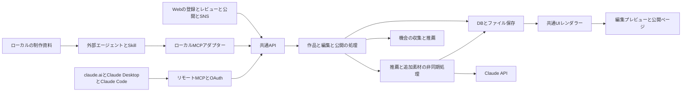

# 作品データとエージェント連携の設計

[プロダクト設計](product.md)を実装へつなぐための技術案。ポートフォリオの作成とAIによる再編集は利用者のコーディングエージェントが担当する。Webは登録と接続設定とレビューと公開とSNSの役割を持つ。推薦やマッチングなどその他のAI機能はサーバー側のClaude APIを使い、利用量と処理状態をサービスで管理する。コーディングエージェント自身の推論利用量は利用者側の契約に属し、サービス側の管理対象と分ける。

## システム構成



TypeScriptとBunを基準にし、WebとMCPが呼ぶ処理を同じコードに置く。UIは共通コンポーネントで構成する。最初は一つのサービスと非同期WorkerとDBとオブジェクトストレージで成立させる。推薦専用の別基盤や独立したサービス群を前提にしない。

公開ページは承認された内容だけを描画する。作品ごとにAIが生成したアプリをビルド・デプロイする構成にはしない。作品の追加はデータの追加として扱う。

## ポートフォリオ作成とWebの分担

| 経路                     | 扱う主体                               | サーバーへ渡すもの                           | 主な用途                           |
| ------------------------ | -------------------------------------- | -------------------------------------------- | ---------------------------------- |
| コーディングエージェント | 指定したローカル資料を読むエージェント | 作品の構造データと選択した根拠資料や画像     | ポートフォリオの作成と追加と再編集 |
| Web                      | 利用者自身                             | プロフィールと手動編集と公開操作と関心の表明 | レビューと公開と交流と機会の発見   |

初回のWeb操作で空のポートフォリオと公開先を用意し、利用するエージェント向けにSkillとMCPの接続手順を表示する。接続後はエージェントが規則とSchemaを取得し、本人が指定した資料を整理して下書きを送る。

サーバーは利用者のローカルパスを直接読まない。ネイティブの常駐アプリは初版の必須条件にせず、連続監視が必要になった時点で追加を検討する。

Skillで最初に扱う資料はテキスト・Markdown・コード・PDF・PNG・JPEG・WebPを想定する。実際の読解能力は利用するエージェントとそのツールに依存するため、未読の資料は未読として報告する。実演動画は関連素材として保持し、PPTX・CAD・独自形式を読めなければ書き出したPDFや画像を使う。

送信前にファイル数とサイズと対象一覧を出す。`.git`・依存関係・ビルド成果物・秘密情報のファイルを通常の対象から除く。正規化した相対パスと内容ハッシュで同じ資料を識別し、別アカウント間で資料を共有しない。初期のサイズ上限は実資料を処理して決め、上限超過は黙って省略せず選び直せるようにする。

作品と取り込み元の対応を保存し、再取り込みではその対応と資料のハッシュから更新候補を作る。フォルダ名だけで同一作品と判断しない。移動や統合で対応が曖昧な場合は既存作品への追加か新規作成かを本人が選ぶ。

元資料はすべて送る必要はない。ローカルのみに保持する根拠とサービスへ送信した根拠を区別し、Webで内容を閲覧できるのは後者に限る。サービス側の推薦は登録された作品データと本人の関心を使い、ローカル資料の再読解を前提にしない。

## 論理データモデル

以下は論理的な単位。初期実装では構造化JSONを活用し、各行を必ず別テーブルにする必要はない。

| 単位              | 主な内容                                               | 関係                                     |
| ----------------- | ------------------------------------------------------ | ---------------------------------------- |
| Profile           | 表示名と公開IDと学校と課程と学年と学科と関心と公開範囲 | 利用者に一件                             |
| Portfolio         | 所有者と公開先とテンプレートと表示設定                 | 空の状態から作成でき複数のWorkを持つ     |
| Import            | 取り込み元とファイル一覧と処理状態と候補               | 複数のSourceと作品候補                   |
| Source            | ファイルとハッシュと参照位置と所有者                   | 作品の根拠                               |
| Work              | 安定したIDと所有者と現在の編集版                       | 複数のWorkRevision                       |
| WorkRevision      | 題名と概要と担当と工夫と状態と制作時期とタグと根拠     | 変更ごとに保存                           |
| ChangeProposal    | 元の版と変更案と対象フィールドと衝突                   | 採用すると次の編集版                     |
| Artifact          | 形式と内容と生成元の版と目的と手動編集箇所             | ページと投稿とスライドと動画             |
| Publication       | 公開用の内容と採用した版と公開URLと状態                | 私的な根拠を含めない公開スナップショット |
| Opportunity       | 公式URLと確認日時と日時と場所と資格と募集状態          | 推薦と参加準備の参照先                   |
| Recommendation    | 対象者と根拠の作品版と理由と条件判定と確認事項         | 本人のための提案                         |
| ParticipationPlan | 機会と目的と関連作品と希望する役割と準備項目と参加状態 | 素材や共同参加の希望を関連付ける         |
| SocialAction      | 公開作品への反応と質問と共同参加の希望とその状態       | 公開情報と本人が共有した情報のみ         |
| Job               | 実行者と処理段階と結果と失敗と利用量                   | 取り込みと生成と推薦                     |
| Connection        | 外部連携の種類と権限と期限と失効状態                   | 本人が接続と解除を管理                   |

経験・関心・希望は別に保持する。Xで話していることは関心の候補であり経験の証拠にはしない。学校情報は在籍時点を持たせ、学年の自動更新や生年月日の推定を行わない。

Sourceには`source_id`とページ・行・画像領域などの参照位置を持つ。主張には資料由来・本人の申告・AIの推定という由来と確認状態を付ける。確認状態は根拠の種類であり数値の能力評価ではない。本人が確認したことをモデル自身の出力で偽装できないよう、確認操作は別の更新として記録する。

## 作品データの例

架空の入力例。本人の実績を表すデータではない。

```json
{
  "schema_version": 1,
  "work_id": "work_example",
  "revision": 3,
  "title": "授業で作った単語帳サイト",
  "kind": "coursework",
  "summary": "覚えたい単語をカードで確認できるサイトです。",
  "period": { "year": null, "precision": "unknown" },
  "project_status": "prototype",
  "contribution": {
    "team_result": "単語カードを表示する試作サイト",
    "my_roles": ["企画", "UI制作"],
    "my_changes": ["カードの見せ方を設計"],
    "verification": "user_confirmed"
  },
  "tags": { "domains": ["学習"], "technologies": ["HTML", "CSS"] },
  "claims": [
    {
      "field": "contribution.my_changes",
      "origin": "user_statement",
      "evidence": [{ "source_id": "source_note", "locator": "本人の補足" }]
    }
  ],
  "next_interest": "誰かに使ってもらって操作を改善したい",
  "asset_ids": ["asset_card_preview"]
}
```

確認状態を含むこの例は保存後のモデル。エージェントの書き込み入力では`user_confirmed`を指定できない。所有者と権限と確認記録はサーバーが設定する。

## 抽出と編集と公開の状態

エージェントからの取り込みは`receiving → validating → ready`を基本とし、失敗と受信終了も記録する。サーバーはローカルの解析進捗を推測せず、受け取った状態を表示する。受信を終了してもローカルのエージェントを自動停止できるとは扱わない。

サービス内の推薦や追加素材のJobは`queued → processing → succeeded`を基本とする。追加の確認が必要な場合は`needs_input`を使う。`failed`と`cancelled`も保持し、作成済みの候補や素材を消さない。

作品は編集版と公開版を別に持つ。編集版の保存で公開版を更新しない。Publicationは`private`・`unlisted`・`public`・`withdrawn`の状態を持ち、初期値は`private`。限定公開URLはURLを知る人が閲覧できるものであり認証付きの私有資料とは区別する。

公開前に対象の作品版・表示内容・画像・関連リンクをプレビューする。公開操作はこの組み合わせに対して行い、承認後に内容が変わっていれば再プレビューへ戻す。公開版から私的なファイルパス・元資料・他者の非公開情報を除く処理を共通化する。

資料の追加や回答による修正は、変更対象と理由を持つ提案にする。人が直接編集したフィールドは保護し、関連する事実が変わった場合には整合しない箇所として見せる。古い版からの書き込みには競合を返し、最後の書き込みで無条件に上書きしない。

Artifactには`source_revision`と`template_version`と`purpose`を記録する。作品が変わると該当素材を更新対象にする。派生素材の手動編集部分との衝突を表示し、採用した変更だけ次の版へ反映する。

## AIと通常のコードが担う処理

| 担当                             | 処理                                                          |
| -------------------------------- | ------------------------------------------------------------- |
| コーディングエージェント         | ローカル資料の読解と作品候補の整理と担当や工夫の抽出          |
| コーディングエージェント         | ポートフォリオの文章とメタデータと画像構成の生成と再編集      |
| サービスのClaude API             | イベントの情報整理と作品に合う理由と仲間や役割と準備の提案    |
| サービスのClaude APIとして仮置き | 投稿やスライドや動画の追加素材の文章と構成                    |
| 通常のコード                     | Schema検証と版管理と競合と公開権限と内容ハッシュの確認        |
| 通常のコード                     | 共通UI描画とPDFや動画の書き出しと確認済みの条件による絞り込み |

資料と外部ページは解釈するデータとして扱い、そこに含まれる命令でファイルの送信先や公開状態を変えない。モデルの生成内容はSchema検証と根拠の確認を通して保存する。

## APIとMCP

APIを作品操作の正本にする。WebとMCPは同じ操作を呼び出す。以下は実装するインターフェース案で、既存のMCP標準Tool名ではない。

| 操作             | REST案                                                        | MCP Tool案                | 返すもの                                 |
| ---------------- | ------------------------------------------------------------- | ------------------------- | ---------------------------------------- |
| 公開先の初期設定 | `POST /v1/portfolios`                                         | 初回はWebから操作         | Portfolio IDと非公開の空のポートフォリオ |
| 規則の取得       | `GET /v1/authoring-rules`                                     | `get_authoring_rules`     | 規則とSchemaと部品の版                   |
| 取り込み開始     | `POST /v1/imports`                                            | `start_import`            | Import IDと選択ファイルの送信先          |
| 送信完了         | `POST /v1/imports/:id/complete`                               | `complete_import`         | 受信と検証の結果とSource ID              |
| 下書きの初回作成 | `POST /v1/works`                                              | `create_work_draft`       | Work IDと編集版                          |
| 作品の取得       | `GET /v1/works/:id`                                           | `get_work`                | 現在の編集版と公開版の概要               |
| 更新案の作成     | `POST /v1/works/:id/proposals`                                | `propose_work_changes`    | 元の版と変更案と衝突                     |
| 更新案の適用     | `POST /v1/proposals/:id/apply`                                | 初版はWebから操作         | 次の編集版                               |
| 素材の生成       | `POST /v1/works/:id/artifacts`                                | `generate_artifact`       | Job ID                                   |
| プレビュー       | `GET /v1/works/:id/preview`                                   | `get_preview`             | 非公開のプレビューURL                    |
| 機会の推薦       | `POST /v1/recommendations`                                    | `recommend_opportunities` | Job ID                                   |
| 進捗の取得       | `GET /v1/jobs/:id`                                            | `get_job`                 | 状態と処理済みの結果                     |
| 公開の準備       | `POST /v1/works/:id/publication-reviews`                      | `prepare_publication`     | 本人が確認する画面URL                    |
| 公開と公開停止   | `POST /v1/publications`・`POST /v1/publications/:id/withdraw` | 初版はWebから操作         | 公開URLと版と状態                        |

取り込み一覧と作品一覧と参加準備とリアクションのCRUDは通常のWeb APIに置く。初版のMCPは作品の生成と更新に必要な操作を中心にする。

`create_work_draft`には接続先の`portfolio_id`を指定し、所有者を検証する。ページの描画は登録された作品データから通常のコードで行う。`generate_artifact`のポートフォリオ形式も再描画を行うだけで、Claude APIによる文章の再生成は行わない。追加素材の文章や構成の生成を依頼した場合にサービス側のClaude APIを使う。

長い処理はJob IDを返し、完了後にプレビューを取得する。書き込みには再送を識別するIDを持たせ、更新案には`base_revision`を必須にする。所有者IDは入力を信用せず認証情報から決める。

プレビューの閲覧には所有者の認証を要求する。公開確認には`review_id`と対象内容のハッシュを保存し、公開APIで同じ内容かを再確認する。連携トークンには公開を確定する権限を与えない。

MCPのToolは入力Schemaを持ち、構造化した結果と出力Schemaを扱える。この仕組みを共通データの検証に使う。Schemaが合うことと文章の事実が正しいことは別に検証する。[MCP Tools仕様](https://modelcontextprotocol.io/specification/2025-11-25/server/tools)

### 認証と接続

Webには通常のアカウント認証を置く。stdioアダプターは利用者がWebで発行した期限付きで失効可能な連携トークンでAPIを呼ぶ。サービスのClaude APIキーを利用者へ配布しない。連携の解除で以後のアクセスを止める。

Claude Codeを使わない利用者に届けるため、同じアプリにStreamable HTTPのリモートMCP`/mcp`とOAuth 2.1の認可サーバーを置く。claude.aiとClaude Desktopはカスタムコネクタに`<APP_ORIGIN>/mcp`を入れるだけで接続できる。ツール定義は`src/mcp-tools.ts`に一つだけ置き、stdioは外部のHTTP APIを、`/mcp`はアプリ内部の`app.fetch`を同じBearerトークンで呼ぶ。ロジックは`/v1`のAPIに残し重複させない。[MCP Authorization仕様](https://modelcontextprotocol.io/specification/2026-07-28/basic/authorization)

- 発見：`/.well-known/oauth-protected-resource`（RFC 9728、`/mcp`付きも同内容）と`/.well-known/oauth-authorization-server`（RFC 8414）。`resource`は`<APP_ORIGIN>/mcp`
- 登録：`/oauth/register`のDynamic Client Registration。redirect_uriはHTTPSかループバックに限り、公開クライアント（`none`）として登録する。Client ID Metadata Documentは未対応
- 認可：`/oauth/authorize`はログインと同意を求める。PKCEはS256だけ。ループバックのredirect_uriはポートを問わず照合する。応答に`iss`を付ける
- トークン：`/oauth/token`はform-urlencodedで受け、認可コードは2分・一回限りでclient_idとredirect_uriとcode_verifierとresourceを照合する。再利用されたコードは発行済みの接続を失効させる
- 寿命：アクセストークン1時間、更新トークン30日。更新のたびに両方を入れ替え古いものは無効にする。保存はSHA-256のハッシュだけ
- 権限：既存の連携トークンと同じで、作品の下書き作成と更新案と画像送信に限る。公開とアカウント管理はWebで本人が行う
- 失効：接続は設定のAgentタブに「Claude（コネクタ）」として表示され、解除するとアクセスと更新の両トークンが止まる
- 保護：`/mcp`はBearer必須でCookieを使わない。Originがあれば自サイト以外を403にし、ループバックで動かすときはHostも確認する。GETとDELETEは405
- 画像：リモートの`upload_image`はサーバーのファイルを読めないようにパスを受けず、2MB以内のbase64だけを受ける
- Skill：`/downloads/kosen-portfolio-skill.zip`で配り、MCP Skills拡張（SEP-2640）でも同じSKILL.mdを返す

### Skillの役割

Skillには、共通規則を読む、指定した資料から候補を見つける、本人の担当を確認する、構造化データを作る、プレビューを確認する、差分を提案するという手順を記載する。UIの全HTMLやCSSを生成させる指示にはしない。

各エージェントのSkill配置や呼び出し方は薄い案内に分け、作品Schemaと文章規則とAPIは共通にする。スラッシュコマンドだけを製品利用の必須条件にしない。

## 機会と推薦の処理

初版は利用者や運営が追加した公式URLと公開募集の少数の情報源から始める。取得と更新はサーバー側で行い、各項目に出典と確認日時を保持する。登録先と取得方法はサービスごとに実装し、無制限なWeb巡回を初期条件にしない。

流れは、募集状態と日時と参加条件で候補を絞る→本人の関心と作品の担当と希望する役割を照合する→理由と準備を生成する→出典との整合を検証して提示する。条件判定は`eligible`・`ineligible`・`unknown`を持ち、未確認を参加可能へ変えない。

作品と本人の希望が変わった場合は推薦の再計算対象にする。準備開始時や公式募集へ進む時点でも情報の鮮度を確認し、変更があれば利用者に示す。未確認の条件が残る場合は確認する場所を案内する。

「行ってみたい」「準備中」「応募済み」「参加済み」「見送り」は本人が更新する。公式サイトを開いた事実だけで応募済みにしない。応募先の外部サービスと状態連携する場合はその結果を明示する。

共同参加の候補には参加意思と共有するプロフィールの範囲を持たせる。推薦の内部理由に私的な資料を使っても、相手に渡す紹介文には共有可能な内容だけを含める。

共同参加の依頼は`pending`から`accepted`・`declined`・`withdrawn`・`expired`へ移る。依頼時に送り手が共有内容を確認し、受け手が応じると双方が共有を選んだ連絡方法を表示する。関心の保存だけでは依頼を送信しない。

## 保存と公開の境界

元資料と下書きと本人向けの推薦は認証付きの領域に保存する。公開用画像は選択したものだけ別の公開資産として扱う。限定公開と公開停止と元資料の削除を別操作にし、それぞれの影響範囲を示す。

フィードは`public`のPublicationから利用者が共有を選んだ項目だけを参照する。限定公開の資料は検索や推薦先の公開プロフィールへ混ぜない。非公開のSourceを根拠にした説明も、原文や参照パスの公開とは切り離す。

公開停止では公開ページとフィードを下げて配信キャッシュを失効させる。既に第三者がダウンロードした素材までは回収できない。共同制作の相手への共有内容も公開ページと同様にスナップショットとして保持する。

## 非同期処理と運用

サービス内のJobはイベント情報の整理、推薦、追加素材の生成などを段階として記録する。失敗した段階から再実行し、同じ入力と規則の版で既に成功した結果は再利用する。UIを閉じてもJobの結果へ戻れる。ポートフォリオの資料読解や文章生成をサーバー側で重ねて実行しない。

アカウントごとに同時実行数と利用上限を設け、利用量と時間を記録する。初期値は一件の実資料による測定で決める。上限時は新規処理を止め、既存の編集とダウンロードは継続できる。価格や処理時間を未測定のまま保証しない。

定期推薦はサービス側のスケジュール処理で実行する。ChatGPTの定期タスクとの連携を基盤の成立条件にしない。Xとカレンダーは接続後に使う追加の入力先・出力先として扱う。

## 実装時の重点確認

別アカウントのWorkやSourceにアクセスできないこと、モデル出力で確認状態や公開権限を上げられないこと、同じ要求の再送で作品や公開が重複しないことを確認する。

WebとMCPの両方で同じ作品Schemaを使い、古い版の更新が競合になることを確認する。人が編集した文章と事実の訂正が衝突した場合、変更案として解決できることも確認する。

公開停止と公開版の差し替えでは、ページと画像とフィードの表示範囲が一致することを確認する。これらと[プロダクトの受け入れ条件](product.md)が最初の実装の検証対象になる。
