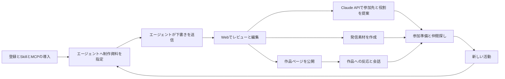

# 高専の制作と校外参加をつなぐプロダクト設計

高専で取り組んだことを、伝わる作品ページと次の活動につなげる。学校や趣味の制作フォルダから経験を整理し、本人が直して公開できるポートフォリオを作る。同じ記録から発信素材を作り、その経験や関心に合うイベントと参加方法と仲間を提案する。

初版のポートフォリオ作成は利用者のコーディングエージェントが担当する。サービスはSkillとMCPと共通UIを提供し、送られた下書きをレビューして公開する場になる。推薦やマッチングなどサービス内のその他のAI機能はClaude APIで実行する。

設計の芯は「高専でやっていることを、次の誘いにつなげる」。制作・発信・参加を往復する一つの製品として設計する。初期の価値は自分の記録と公開ページで成立し、他の利用者が増えると作品への反応や共同参加の価値が加わる。

根拠は[本人の経験と構想](context.md)。データと連携の詳細は[データとエージェント連携設計](architecture.md)。この文書は初版の設計案であり実装済みの仕様ではない。

## 決まっている要件と今回の設計判断

| 種別           | 内容                                                              |
| -------------- | ----------------------------------------------------------------- |
| 本人の要件     | 学校・学年・学科を含むアカウント情報                              |
| 本人の要件     | ローカルの制作からポートフォリオを半自動作成                      |
| 本人の要件     | r1ca18.devを基準にした共通UIと説明の規則                          |
| 本人の要件     | 年・タグによる整理と新しい作品の追加                              |
| 本人の要件     | 人が編集して公開を決める流れと共通ホスティング                    |
| 本人の要件     | コーディングエージェントによるポートフォリオ作成とSkillとMCP／API |
| 本人の要件     | 推薦やマッチングなどその他のAI機能はClaude APIを使用              |
| 本人の要件     | 投稿・スライド・短い動画などの発信素材                            |
| 本人の要件     | 作品と関心に基づくイベントや仲間の提案                            |
| 本人の要件     | 作品や機会が流れるホームとリアクション                            |
| 設計上の仮置き | 最初の対象は制作経験が一件以上あり校外にも関心がある高専生        |
| 設計上の仮置き | Webで登録・レビュー・公開・交流を行い作成は外部エージェントへ渡す |
| 設計上の仮置き | 活動一件を作品の単位にする。授業課題や企画や動画も含む            |
| 設計上の仮置き | 初版の公開URLは共通ドメインのユーザー別パス                       |
| 設計上の仮置き | 公開版と編集途中の版を分けて保持                                  |
| 設計上の仮置き | 発信や参加は本人の選択。推薦から自動応募しない                    |

## 対象者と得られる変化

中心となるのは、授業や趣味で何かを作った経験があり、その経験を外でどう見せて使えるかがまだ曖昧な学生。既に発信している学生も更新と再利用の負担を減らせる。プログラミングの経験量で利用資格を決めない。

初回の成功は、作品一件について本人の担当と工夫が伝わるページができ、公開するかを選べること。次の成功は、具体的な参加先を一つ見つけ、そこで何をしたいかと準備すべきものが分かること。

高専の文脈は入力欄だけでなく判断に使う。配布教材と本人の変更、班全体の成果と担当、制作時の学年と現在の学年、学んだことと今後やりたいことを分ける。学年から年齢を決め付けず、イベントの年齢条件がある場合に必要な確認を行う。

## 全体の利用の流れ

| 順序 | 利用者の操作                                 | システムの動作                                                            |
| ---- | -------------------------------------------- | ------------------------------------------------------------------------- |
| 1    | ユーザー登録                                 | アカウントとプロフィールを作る                                            |
| 2    | ポートフォリオを初期設定してSkillとMCPを導入 | 空のポートフォリオと公開先と接続先を用意する                              |
| 3    | 普段のエージェントへ制作フォルダを指定       | エージェントが規則を読み資料から作品を整理する                            |
| 4    | 必要な補足に答える                           | エージェントが各作品の内容と年とタグと画像参照を作りMCP経由で下書きを送る |
| 5    | Webでレビューして必要な修正を行い公開        | 共通UIでプレビューし選択した版を公開する                                  |
| 6    | 作品や人を見て反応する                       | 公開と共有の設定に従ってフィードと接点を作る                              |
| 7    | 自分に合うイベントや仲間を見つける           | Claude APIで経験と関心と条件を照合して提案する                            |

2は公開先と接続の準備であり、作品内容の生成は3と4で行う。6と7は並行して使える。本人向けの機会の推薦はプロフィールと本人が確認した作品情報がそろえば開始でき、他の利用者の反応を待たない。



初回登録は表示名と公開URL用IDを必須にする。学校・課程・学年・学科は後から補足できる。関心分野と今回してみたいことは短い自由入力でも登録できる。学校情報の登録と公開は別に選ぶ。

接続設定では利用するエージェントに合わせてSkillとMCPの導入手順と接続確認を表示する。ローカル資料の読解と作品候補の整理はエージェントが行い、サービスには作品データと選択した画像や根拠を送る。学校フォルダ全体から始めても作品候補を複数提示し、整える作品を選べる。すべての課題を自動公開する動作にはしない。

本人への質問は、紹介の正確さや推薦を変えるものを優先してまとめる。「自分が担当した部分」「実際に動いた範囲」「作った時期」など。分からない項目は未確認として残し、他の編集を進められる。

## 情報構造と画面

ログイン後の主な移動先はホーム・作品・機会・プロフィール。作品の編集と素材生成は同じ作品詳細の中に置く。通知と連携設定はヘッダーから開く。

| 画面と経路案                      | 主な内容                                       | 主な操作                                 |
| --------------------------------- | ---------------------------------------------- | ---------------------------------------- |
| ホーム `/home`                    | 自分の下書きと作品の投稿と参加候補と仲間募集   | 続きを編集・気になる・質問する           |
| 作品一覧 `/works`                 | 年別とタグ別の作品。非公開と公開の区別         | エージェントで追加・作品を開く・並び替え |
| 接続設定 `/settings/agents`       | SkillとMCPの導入と接続確認                     | 導入案内を開く・接続を確認する           |
| 取り込み `/imports/:id`           | エージェントから届いた候補と送信状態と確認事項 | 候補を開く・内容を確認する               |
| 作品編集 `/works/:id`             | 元資料と作品内容とプレビューと素材             | 編集・生成・更新案を確認・公開           |
| 機会一覧 `/opportunities`         | 自分への候補と検索と保存済み                   | 条件で絞る・詳細を開く・見送る           |
| 機会詳細 `/opportunities/:id`     | 公式情報と自分に合う理由と参加条件             | 気になる・準備を始める・公式募集を見る   |
| 参加準備 `/plans/:id`             | 目的と役割と必要な素材と小さな準備項目         | 素材を作る・役割を補足・参加状況を更新   |
| プロフィール `/profile`           | 自己紹介と所属と関心と連絡先と公開設定         | 編集・公開プレビュー                     |
| 公開ポートフォリオ `/u/:handle`   | 公開した自己紹介と作品と参加希望               | 年やタグで見る・作品を見る               |
| 公開作品 `/u/:handle/works/:slug` | 一件の内容と本人の担当と関連リンク             | 反応・質問・本人が選んだ連絡先へ進む     |

`/plans`はイベントや発表先にひもづく準備の画面。一般的なタスク管理を別の製品として広げない。

### ホーム

上部に「自分の続き」を置く。下書きの編集、選んだイベントの準備、返ってきた質問などを表示する。その下のフィードでは作品・機会・募集をカードの見出しで区別する。

作品カードには画像、短い説明、本人の担当、制作時期、少数のタグを置く。イベントカードには開催日と場所と参加条件と推薦理由を置く。「なぜ自分に表示されたか」は作品や本人が登録した関心へたどれるようにする。

最初の利用者しかいない場合は、自分の作品と出典を確認した外部の機会を表示する。架空の利用者やリアクションで埋めない。情報が見つからない場合は条件を広げる操作と公式ページのURL追加を用意する。

作品の公開時に「ホームにも共有」を選べるようにする。限定公開の作品はフィードへ出さない。公開ページを更新しただけで投稿を増やさず、利用者が共有したい変更を選ぶ。

### 作品編集とStudio

PCでは左に共有した資料と根拠、中央に作品プレビュー、右に修正と素材の操作を置く。狭い画面では資料・作品・素材のタブへ切り替える。ローカルにだけ残した資料は参照情報を表示し本文の閲覧には対応しない。チャットを使わなくても内容を直接編集できる。

```text
作品一覧へ   作品名                     下書き   公開する
-------------------------------------------------------
資料            作品プレビュー               編集と素材
レポート        題名と画像                   内容を編集
コード          何を作ったか                 エージェントで修正
画像            自分が担当したこと           投稿文
本人の補足      工夫と試行錯誤               スライド
                結果と次にしたいこと         ショート動画
-------------------------------------------------------
確認が必要です：制作時期を確認してください。
```

本人はWebでの直接編集とコーディングエージェントへの修正指示を使える。ポートフォリオのAIによる再編集もエージェントが担当する。OSの音声入力でエージェントへ補足でき、製品内の録音と文字起こしは追加機能とする。修正によって影響する素材を一覧表示し、変更案を確認して反映する。手で直した部分との衝突を黙って上書きしない。

### 機会詳細と参加準備

「どんな機会か」「自分がどう関われるか」「参加できる条件」「準備すること」の順で表示する。例としてUI制作を経験した学生には、その経験を使える役割と今回学びたい役割を分けて提案する。完成品の機能だけから全実装を担当できると判断しない。

出典URLと確認日時を表示する。締切や資格の情報が欠ける場合は「条件の確認が必要です」と示す。本人が「準備を始める」を選ぶと、関連する作品と目的と必要な素材を持つ準備画面を作る。

## 公開ポートフォリオの共通ルール

[r1ca18.dev](https://r1ca18.dev/)の異なる形式の活動を並べる構成を基準にする。初版は共通テンプレートと部品で描画し、本人が画像・文章・並び順・アクセントを選べる設計にする。色やフォントの具体値は画面制作時に確認して決める。

| 項目       | 規則                                                             |
| ---------- | ---------------------------------------------------------------- |
| 入口       | 自己紹介と主な関心と代表作品を先に見せる                         |
| 作品カード | 実際の画像と一文の説明を中心にする                               |
| 詳細の順序 | 何を作ったか→担当→工夫→確認できた結果→次にしたいこと             |
| 文章       | 読み手が知らない授業名や技術名には短い説明を添える               |
| 貢献       | 班全体の成果と本人の担当を別に書く                               |
| 結果       | 完成・試作・検討中を区別し数値を創作しない                       |
| 年         | 制作時期を使う。ファイル更新日時を制作年と断定しない             |
| タグ       | 分野と扱った技術と担当を分ける。本人が直せる                     |
| 画像       | 現物や録画や本人の制作物を使う。存在しない動作を実績画像にしない |
| 操作       | キーボードで編集と公開を完了できる。状態を色だけで示さない       |

年やタグは表示と検索に使う。能力の順位付けや他の学生との優劣の表示には使わない。

## 素材の生成と更新

| 素材           | 生成する内容                     | 編集と持ち出し                                       |
| -------------- | -------------------------------- | ---------------------------------------------------- |
| ポートフォリオ | 共通構成の作品ページ             | 直接編集と公開URL                                    |
| X投稿          | 制作の工夫と画像と公開URL        | コピーと画像ダウンロード。投稿連携時は送信内容を確認 |
| スライド       | 選んだ発表時間と目的に合う構成   | 編集可能な構造データとHTML表示とPDF出力              |
| ショート動画   | 実画像と録画と図と字幕を使う説明 | 場面と字幕を編集してMP4へ出力                        |

既存の発表資料がある場合は関連素材として残し、目的に合えば利用する。既存資料を解析・編集できる形式は明示し、未対応の元ファイルは添付と手動利用にする。

素材は生成元の作品の版と目的を記録する。作品を訂正した場合は関連素材を「更新案あり」にする。公開中のページは本人が更新を決めるまで直前の公開版を維持する。誤った説明をすぐ下げたい場合は公開停止を選べる。

ポートフォリオのページと文章とメタデータはコーディングエージェントが作る。投稿・スライド・動画の追加素材は、作品データを使うサービス内のAI機能としてClaude API側へ置く設計案とする。この追加素材の担当範囲はポートフォリオ作成の担当とは別の仮置き。

## 機会の推薦と人との接点

候補にはハッカソン、LT、展示、コミュニティ活動、学外プログラムを含める。日程・場所・参加資格・既存作品の扱いを先に確認し、経験と関心と希望する役割から理由付きで提案する。本人が見送った理由も次回に反映する。

過去の制作を提出できない大会には、経験を使って新しく取り組む題材を提案する。既存制作の完成と紹介を進めたい場合は、その作品を見せられる場を探す。

仲間の候補は同じ機会への参加意思を示した利用者と、募集が確認できる外部のページから探す。プロフィールを読んだだけの人を参加希望者として扱わない。提案には一緒にしたいことと各自の役割と作業可能な条件を添える。

リアクションは「気になる」と作品への質問から始める。「一緒に参加したい」はイベントと希望する役割にひもづける。相手が受け入れた後に双方が選んだ連絡方法へ進む。誰からでも直接連絡できる巨大なDM機能は初版の中心に置かない。

本人だけの関心や未公開資料を他者へ露出させず、紹介には本人が共有を選んだ内容を使う。共有作品への質問には削除・通報・ブロックの入口を置く。

## 継続利用

新しい制作は同じSkillとMCPから追加する。エージェントが既存作品を取得し、新しい資料による更新候補を送る。未完成の作品には、見せたい場に向けて次に完了できる作業を提案する。ソースコードの修正は外部エージェントで行う経路を使い、初版のWebサービスを任意コードの実行基盤にはしない。

新しい機会は設定した頻度でホームに反映する。定期通知、X連携、カレンダー連携は本人が有効にする。カレンダーへ入れる候補は参加確定と区別し、接続する場合は候補専用の予定として扱う。機会を保存することと応募することと参加したことは別の状態として残す。

## 空の状態と失敗時の動作

| 状況                   | 画面と次の行動                                           |
| ---------------------- | -------------------------------------------------------- |
| 作品がまだない         | SkillとMCPの接続とエージェントへ渡す依頼文を案内         |
| 取り込み中             | 受信済みの候補を表示。エージェントからの未送信部分と区別 |
| 対応しない形式         | 対象ファイルを示し画像やテキストや説明の追加を案内       |
| 本人の担当が分からない | 質問を表示。回答なしでも下書きは保存                     |
| 一部の生成が失敗       | 作成済みの素材を保持して失敗した素材だけ再試行           |
| 更新が競合             | 両方の変更を示して残す内容を選ぶ                         |
| 合う機会がない         | 条件変更と機会URLの追加と既存作品の編集へ進める          |
| 募集が終了             | 候補から外し保存済みの詳細に終了を表示                   |
| 公開に失敗             | 直前の公開版を保持して再試行                             |

## 実装の順序

全体設計には上記を含める。11月8日20時の提出へ向けた順序は、一人の資料が公開ページと次の活動につながる動作を先に通す。

| 段階 | 実装する範囲                                                 | 動作で確認すること                              |
| ---- | ------------------------------------------------------------ | ----------------------------------------------- |
| 1    | アカウントとSkillとMCPと作品データと共通UIと下書き編集と公開 | エージェントで作った一件を自分のURLで見せられる |
| 2    | 機会の取り込みと条件確認と推薦と参加準備と投稿文             | その作品を持って次に何をするか選べる            |
| 3    | エージェントでの追加と再編集とWebの手動編集の調整            | 更新時にも同じ作品とプレビューを使える          |
| 4    | スライドと修正の反映とホームと基本リアクション               | 同じ作品から素材と会話の入口ができる            |
| 発展 | 動画出力とXの関心取得とカレンダーと共同参加の調整            | 手動で行っていた連携の負担が減る                |

これは実装順の提案であり全段階の期限内完成を見積もったものではない。段階1と2が動く状態を最初に確保し、本人の訂正で説明と推薦が変わる部分をデモの中心にする。

画面への移動と自分の下書きを扱うホームは段階1で用意する。段階4では他の人の作品とリアクションを加える。

## デモと検証

3分では、一人の学生の資料が公開と具体的な参加準備へ変わる過程を見せる。初めに資料と本人の困りごとを示し、作品ができる場面、担当を訂正する場面、推薦と素材が変わる場面、選んだ次の行動を続ける。実行していない外部参加や会話を実績として演出しない。

受け入れ条件は次の通り。

1. 同じ資料を再取り込みしても作品が重複せず更新候補になる
2. 制作年が不明なら不明として保持できる
3. 班の作品について本人の担当を編集でき紹介に反映される
4. 下書きと未公開資料が公開URLやフィードに出ない
5. 本人の訂正が関連素材の更新案になり手動編集は衝突として確認できる
6. 公開したページを別の閲覧者が開いて本人の担当を理解できる
7. 推薦に公式の出典と開催条件と本人に合う理由がある
8. 参加資格が未確認の候補を参加可能と断定しない
9. 利用者が一人でも記録と公開と外部の機会の発見が機能する
10. 外部エージェントから作った作品も同じ表示規則と公開手順を使う
11. 参加候補の保存が応募や参加済みへ勝手に変わらない
12. 処理失敗や画面の再読み込みで作成済みの下書きを失わない

測定するのは、初回ページの完成までの本人の作業時間、誤った貢献表示、修正量、受け手の理解、本人が選んだ次の行動。投稿数や推薦数だけを成功指標にしない。参加実績と継続利用は後から確かめる。

## 実装前に残る選択

名称とドメインと認証サービスとインフラ事業者は未確定。最初の利用者と実資料とデモの参加先もまだ選んでいない。これらを待たず作品データと共通UIと下書き編集の構造は作れる。入力資料の用意と今回新しく実装する範囲は[参加者ガイド](hackathon.md)に合わせて区別する。
